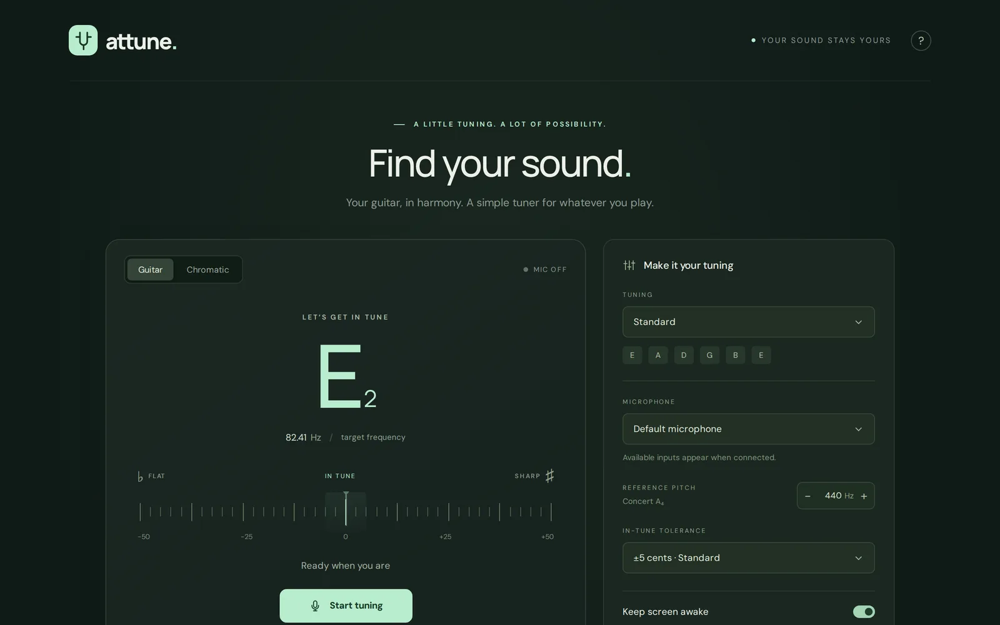
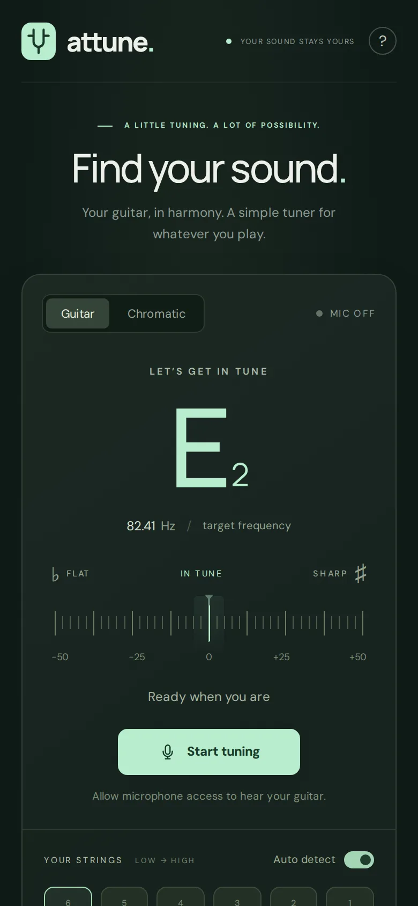

# Attune

 

**▶ Try it live: [shoryuken.me/at](https://shoryuken.me/at/)** · mirror on [GitHub Pages](https://ali-raheem.github.io/attune-guitar-tuner/) · installable, works offline

  
  

A guitar tuner built with browser-native audio and no runtime dependencies.

Run `npm start` and open **http://localhost:3000**. Node.js 18 or newer is required. Run `npm test` to verify pitch detection and tuning calculations.

Features: nine common guitar tunings, automatic or manual string selection, chromatic mode, selectable microphone inputs, a cents meter, 420–460 Hz concert A calibration, adjustable reference tones, and an optional in-tune confirmation chime. The chime follows 0.6 seconds within the selected tolerance (±2, ±5, ±10, ±15, or ±20 cents; default ±5), plays once per string until a sustained detune or new session, and briefly pauses microphone analysis to avoid feedback. The In-tune sound and tolerance settings are saved on this device. Keep screen awake is on by default while tuning or playing reference tones; it releases when you stop or hide the app and reacquires on return. Devices can deny a wake lock in battery saver; the setting shows its current status. Tuning and calibration preferences are saved on this device. Reference tones stop after eight seconds; microphone analysis pauses during playback.

Microphone access requires user permission and **HTTPS or localhost**. When accessing from a phone or another computer, serve the app over HTTPS. Audio stays in the browser and is never recorded or uploaded. Fonts are bundled locally with their SIL Open Font License notices in `fonts/`; the app makes no external font requests.

The pitch detector uses YIN with a quiet-input gate and median smoothing. For best results, use a quiet room and pluck one string at a time. Browser processing and microphone quality can affect accuracy.

## Installation and offline use

Open the deployed HTTPS site once while connected to let the app cache its assets. In Chrome on Android, choose **Install Attune** when offered, or use the browser menu's **Install app** / **Add to home screen → Install** option. The app opens in a standalone window and can reload offline, including its fonts, microphone tuner, and reference tones. Android installation behavior depends on the browser and device; Chrome with Google Mobile Services supports WebAPK installation. An old home-screen shortcut may need to be removed and replaced by a fresh installation.

The manifest and service worker use relative paths, so deployment at `/at/` works without a build step. Copy `index.html`, `styles.css`, `app.js`, `pitch.js`, `confirmation.js`, `keep-awake.js`, `version.js`, `pwa.js`, `sw.js`, `favicon.svg`, `manifest.webmanifest`, and the complete `icons/` and `fonts/` directories to the public `/at/` directory. Serve `/at` with a redirect to `/at/`. Serve the manifest as `application/manifest+json` and JavaScript as `text/javascript` or `application/javascript`; keep `sw.js` revalidatable (`Cache-Control: no-cache`). No Node process is needed on a static host.

When releasing changes, commit the source and run `npm run build`, then upload all assets together. This generates `version.js` with the source commit, build time in GMT, and a unique offline-cache version. The footer displays `AtTune [commit] YYYY-MM-DD HH:mm:ss GMT`; uncommitted builds are marked `-dirty`, and source exports without Git are marked `unversioned`. Generated `version.js` is ignored by Git but must be deployed. The service worker imports it so browsers detect each new build. Each version caches the entire app during installation; an incomplete download leaves the previous version in place. Updates activate after all existing app windows close. Caches are isolated by deployment path, so `/at/` does not delete other apps' caches. Offline availability lasts while the browser retains the site's storage; clearing site data requires one online visit again.

Installability background: https://developer.mozilla.org/en-US/docs/Web/Progressive_web_apps/Guides/Making_PWAs_installable

## Licence

[MIT](LICENSE) © 2026 Ali Raheem. The bundled fonts in `fonts/` (DM Sans and Manrope) are under the SIL Open Font License 1.1; see their notices in that folder.
